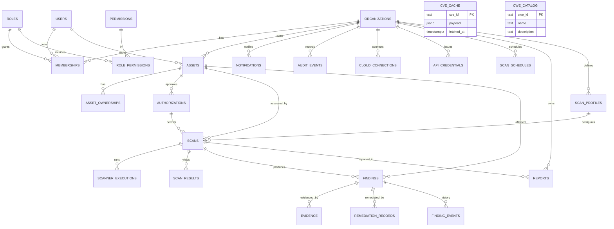

# Database architecture

PostgreSQL is the source of truth. Migrations are embedded in the Go binary and applied transactionally (`apps/api/internal/db/migrations`). IDs are UUIDs generated by `pgcrypto`. All tenant tables carry `org_id`; every query is scoped through it.

## ER diagram

## Key tables

### Identity and tenancy

- `organizations` — tenant root. `emergency_stop` blocks new scans immediately.
- `users` — email is normalized lowercase with a unique index. `password_hash` is Argon2id encoded.
- `roles`, `permissions`, `role_permissions` — seeded RBAC (`owner`, `admin`, `analyst`, `viewer`).
- `memberships` — unique `(org_id, user_id)`.
- `sessions` — stores only `sha256(token + pepper)`. CSRF token stored alongside. Expiry and revocation are enforced server-side.

### Assets and authorization

- `assets` — `type` CHECK covers website, web_app, api, graphql_api, ip, network, cloud, server, container, internal. `target` stores a normalized host/URL/CIDR, never a scanner command.
- `asset_ownerships` — owners and business contacts with a relationship label.
- `authorizations` — the legal gate. Fields: reference, approver identity, validity window, `intrusive_allowed`, `allow_private`, scope notes, optional evidence object key. Revocation is an immediate status change plus an audit event.
- `scan_profiles` — system profiles (`is_system = true`, `org_id = NULL`) and org-customized profiles. Config is JSON validated against a per-scanner allowlist.

### Assessment execution

- `scans` — snapshots `target_snapshot` and `config`, carries `status` CHECK, `progress`, `cancel_requested`, and JSON summary. State machine: queued → running → completed | failed | cancelled. `pending` is reserved for scheduled-but-not-queued work.
- `scanner_executions` — one row per adapter invocation, including a bounded command summary (never secrets), exit code, output excerpt, timings.
- `scan_results` — immutable normalized output of a scan, one row per raw result. Used for comparison and traceability.
- `findings` — deduplicated across scans by `(org_id, fingerprint)`. Triage fields and lifecycle status live here so re-scans do not reset an accepted-risk decision.
- `finding_events` — append-only status/assignment/severity history.
- `evidence` — metadata + storage key + SHA-256; uploads validated by MIME allowlist, magic bytes, and size limit.
- `remediation_records` — actions taken, performer, deadline.

### Outputs and operations

- `reports` — immutable snapshot reference, HTML/PDF object keys, summary JSON.
- `notifications` — per-user or org-wide, read state.
- `audit_events` — actor, action, resource, metadata, request IP and user agent. Append-only convention; no update/delete API.
- `cloud_connections` — AES-256-GCM encrypted credential blob + nonce. Decrypted only at job dispatch into the internal job payload (never returned to the browser).
- `api_credentials` — hashed bearer tokens (`km_...`), scopes, prefix for display, revocation.
- `scan_schedules` — cron expression, next run, last run, enabled. A scheduler goroutine in the API enqueues due jobs with the same authorization checks as manual scans.
- `cve_cache`, `cwe_catalog` — vulnerability intelligence cache and classification reference.

## Constraints and indexes

- FKs use `ON DELETE CASCADE` for child records; assets are archived rather than deleted once scanned.
- CHECK constraints on all statuses, severities, environment values, scanner names, provider names and cloud statuses.
- Partial unique index on active authorizations per asset to prevent overlapping duplicate approvals is intentionally avoided (multiple approvals can coexist); scan creation selects one explicitly.
- Indexes: `assets(org_id, status)`, `assets(org_id, type)`, `scans(org_id, created_at desc)`, `scans(org_id, status)`, `findings(org_id, severity, status)`, `findings(org_id, asset_id)`, `findings(org_id, last_seen desc)`, `audit_events(org_id, created_at desc)`, `notifications(user_id, read_at)`, GIN on `assets.tags`.
- Full-text search uses `to_tsvector` indexes on findings title/description and assets name/target.

## Retention

`scripts/retention.sql` deletes expired evidence/report objects and audit events older than the org retention policy, and vacuums. Scheduled externally (cron) or via `docker compose run --rm retention`. Findings are never auto-deleted; scans older than retention lose raw output but keep findings.

## Migrations

`kmctl migrate` applies `*.sql` in lexical order inside a transaction, recording checksums in `schema_migrations`. Migrations are forward-only. Development resets use `make db-reset` (documented in deployment docs).
