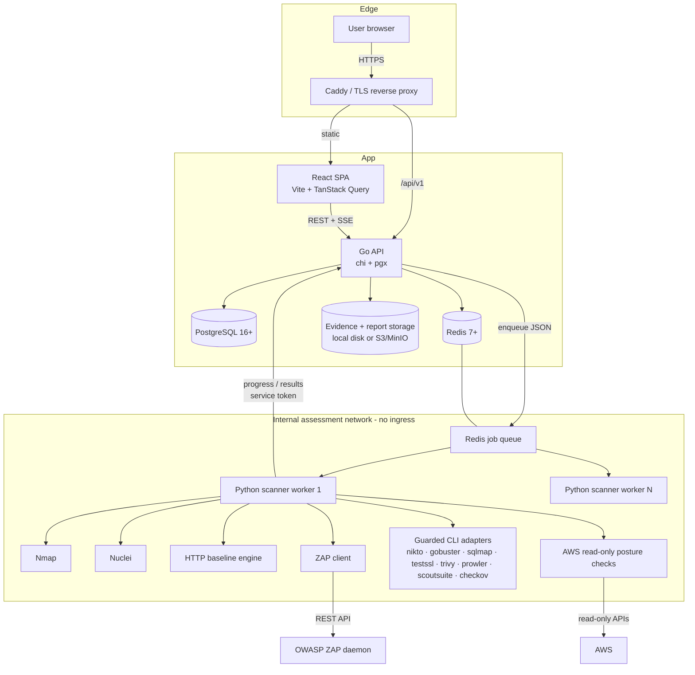

# King Malhare - System Architecture

## 1. Context

King Malhare is a self-hosted offensive security workstation. It is designed for a security engineer or a small security team testing assets they own or are contracted to assess. The platform is deliberately split so that no untrusted scanner output, hostile target response, or cloud credential is handled by the public API process.

**Design principles**

1. **Authorize before you scan.** An asset is inert until it has a valid, unexpired authorization record. Scope is snapshot into every scan job and re-validated by the worker.
2. **The API never runs scanners.** Scanner processes are executed only in dedicated workers, inside containers with dropped capabilities and an internal-only network.
3. **Normalize at the edge.** Each scanner emits its native format; adapters map it to one vulnerability schema before it reaches the database.
4. **Facts only.** Progress, logs, and findings come from real executions. Missing tools report `unavailable`, not simulated data.
5. **Tenant isolation at the query layer.** Every business query is scoped by `org_id`; authorization tests cover cross-tenant reads and writes.

## 2. Component diagram



## 3. Component responsibilities

| Component | Responsibility | Must not |
| --- | --- | --- |
| React SPA | Presentation, filters, live progress, drafting scans and reports | Hold cloud secrets, run scans, trust client-side authorization |
| Go API | AuthN/AuthZ, validation, scope enforcement, queueing, aggregation, reporting | Spawn scanner binaries, expose worker ports |
| PostgreSQL | Source of truth, findings, audit, cached intel, auth records | Store plaintext secrets or raw cloud keys |
| Redis | Job queue, cancellation, SSE fan-out, rate limiting, scanner heartbeats | Persist authoritative findings |
| Python worker | Consume jobs, validate scope, run adapters, normalize output | Run arbitrary user-supplied commands, access other tenants |
| ZAP daemon | Optional active/passive web scanning behind the worker | Be reachable from the internet |
| Storage | Evidence, generated HTML/PDF reports | Be publicly listable |

## 4. Request lifecycle - starting a scan

```mermaid
sequenceDiagram
  participant U as Browser
  participant A as Go API
  participant DB as PostgreSQL
  participant R as Redis
  participant K as Scanner worker

  U->>A: POST /assets/{id}/authorizations
  A->>A: validate permission, dates, scope
  A->>DB: insert authorization
  U->>A: POST /scans {asset, authorization, scanner, profile, params}
  A->>DB: asset + authorization + profile lookup (org-scoped)
  A->>A: authorize_target(asset, auth, scanner, intrusive consent)
  A->>DB: insert scan(status=queued) + scope snapshot
  A->>R: LPUSH scan job JSON
  A-->>U: 202 {scan}
  K->>R: BRPOP job
  K->>A: POST /internal/worker/jobs/{id}/claim (service token)
  A->>DB: conditional update queued→running
  K->>K: revalidate target against snapshot; run adapter
  loop execution
    K->>A: POST progress {phase, pct, message}
    A->>DB: update scan progress
    A->>R: PUBLISH scan:{id}
    R-->>A: SSE fan-out to browser
  end
  K->>A: POST results (normalized findings batch)
  A->>DB: upsert findings, link evidence
  K->>A: POST complete {status, summary}
  A->>DB: finalize scan
  A->>R: PUBLISH scan:{id}
```

If the worker dies mid-job, the API's stale-job reaper marks the scan `failed` with an actionable message; it does not automatically re-run an intrusive scan. Cancellation sets `cancel_requested` and pushes a cancellation key; the worker kills the active child process group and reports `cancelled`. The organization-level emergency stop sets a Redis kill flag and marks every queued/running job cancelled before the worker picks up work.

## 5. Modular backend layout

```
apps/api/internal/
  config        environment parsing and validation
  db            pgx pool, embedded SQL migrations
  security      Argon2id, token hashing, AES-GCM, CSRF, rate limits
  api           router, middleware, handlers (HTTP boundary only)
  scanner       queue client, target/scope policy, job payload
  reports       HTML template + PDF renderer, report assembly
  storage       local and S3-compatible object storage
  intel         CVE/CWE providers + cache
  audit         audit writer
```

The API is a single deployable binary with packages acting as modules. Scanner-specific code lives outside the API entirely.

## 6. Data flow for findings

```
native scanner output
   → adapter parser (strict, bounded)
   → normalized Result {title, severity, cve, cwe, cvss, endpoint, evidence, fingerprint}
   → POST /internal/worker/jobs/{id}/results
   → API validates enums/ranges/fingerprint
   → upsert scan_results
   → upsert findings by (org_id, fingerprint): update last_seen, first_seen preserved, status preserved
   → notification + audit event
   → UI / report
```

Fingerprints are deterministic: `sha256(scanner | normalized title | endpoint | cve-or-cwe)`. Re-running a scan updates `last_seen` instead of creating duplicates, while the finding's triage status survives.

## 7. Availability and failure behavior

- Scanner binaries are detected at worker startup; heartbeat JSON is written to Redis every `WORKER_HEARTBEAT_SECONDS`. Integrations page reads this.
- If Redis is down, scans cannot be queued and the API returns `503` with a typed error; no in-process fallback execution.
- If a scanner times out, its child process group receives SIGTERM then SIGKILL, the execution row records the timeout, and the scan fails with a partial-results note.
- SSE reconnects with `Last-Event-ID`; the API replays the current scan state on connect, then streams updates. The UI also polls every 15 seconds as a safety net.

## 8. Non-goals for this iteration

- Multi-region active/active deployment.
- A public multi-tenant SaaS offering. Tenant isolation exists, but deployment is single-organization-team oriented.
- Azure/GCP native live posture collection. The adapter contract and CLI wrappers exist; native SDK checks currently cover AWS.
- Distributed job fairness beyond Redis FIFO and per-org queue limits.
